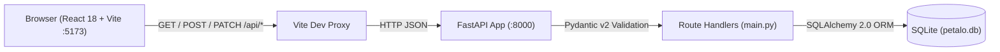
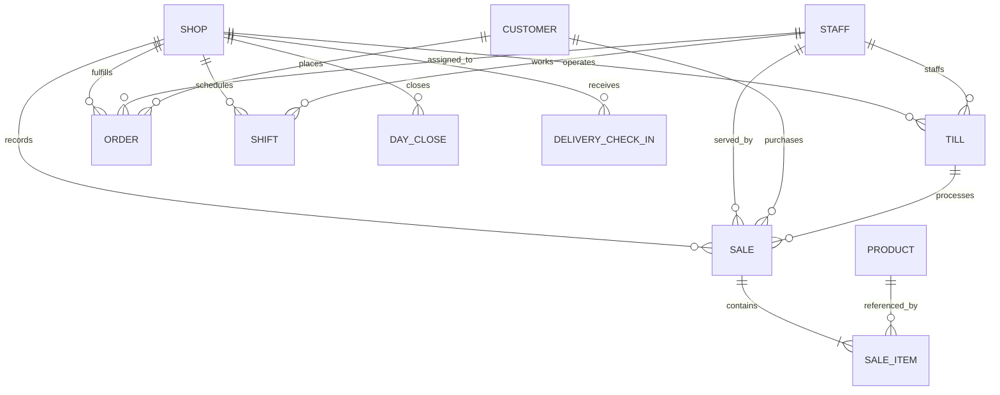
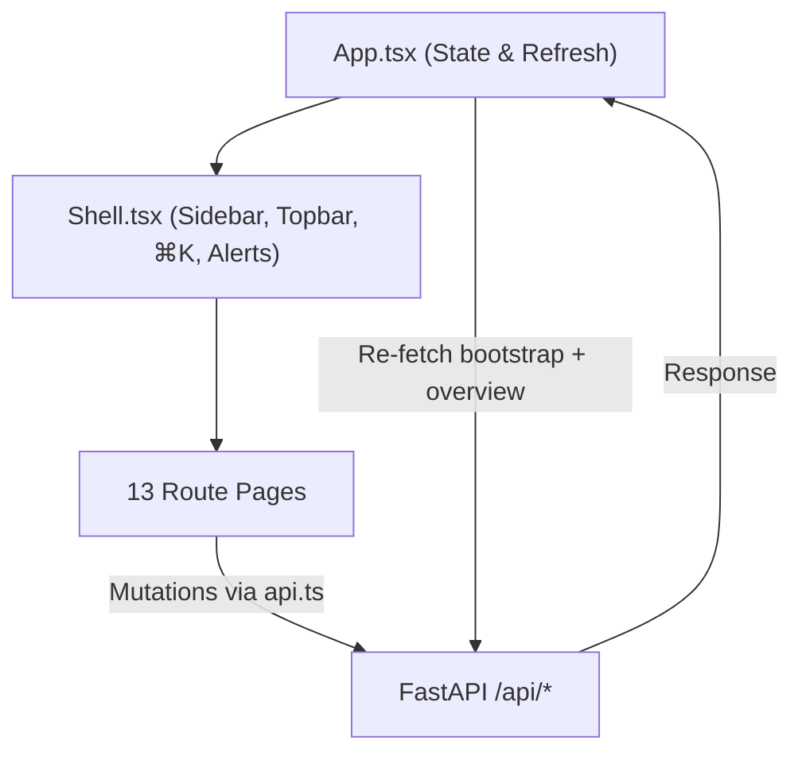

# Architecture — Petalo POS & Back Office

This document describes the technical architecture, data model, transactional flows, and design system of **Petalo (Marigold & Moss POS & Back Office)**.

---

## 1. System Overview

Petalo is a decoupled client–server web application:

- **Frontend**: Single-page application built with **React 18**, **TypeScript**, and **Vite**.
- **Backend**: **FastAPI** REST API backed by **SQLite** via **SQLAlchemy 2.0** and validated with **Pydantic v2**.
- **Dev Proxy**: Vite forwards `/api/*` requests from `:5173` to the FastAPI server on `127.0.0.1:8000`.

---

## 2. Backend Architecture (`backend/`)

### 2.1 Module Responsibilities

| File | Responsibility |
| :--- | :--- |
| `database.py` | Configures the SQLite SQLAlchemy engine (`check_same_thread=False`), `SessionLocal`, declarative `Base`, and `get_db` dependency. |
| `models.py` | Defines 12 ORM tables: `Shop`, `Staff`, `Product`, `Customer`, `Order`, `Till`, `Sale`, `SaleItem`, `Shift`, `DeliveryCheckIn`, `DayClose`, and `AppSettings`. |
| `schemas.py` | Pydantic input models (`SaleCreate`, `OrderCreate`, `OrderUpdate`, `ProductCreate`, `ProductUpdate`, `CustomerCreate`, `CustomerUpdate`, `ShiftCreate`, `ShiftUpdate`, `TillCloseIn`, `DayCloseCreate`, `SettingsUpdate`). |
| `seed.py` | Idempotent database seeder (`seed_database`) populating Marigold & Moss shops (`canal`, `market`), staff, catalog products/stems, orders, historical sales, tills, shifts, deliveries, and settings. |
| `main.py` | FastAPI lifespan (creates tables & seeds), CORS middleware, `_compute_overview` aggregation engine, and all REST endpoints. |

### 2.2 Entity-Relationship Model

### 2.3 Transactional Integrity

- **Atomic Checkout (`POST /api/sales`)**:
  1. Computes `subtotal_cents`, `discount_cents` (`Regular 10%` or `Staff 20%`), `tax_cents` (using `AppSettings.tax_rate_pct`), `total_cents` (including `tip_cents`), and `change_cents`.
  2. Creates `Sale` and child `SaleItem` records.
  3. Decrements `Product.stock_qty` (clamped at `0`) for catalog items.
  4. Increments `Till.expected_cash_cents` when `payment_method == "Cash"`.
  5. Increments `Customer.total_spent_cents` and `Customer.visits_count` when a customer is attached.
  6. Commits in a single database transaction.
- **Refund Guard (`POST /api/sales/{id}/refund`)**:
  - Rejects already-refunded sales with HTTP `400` to prevent duplicate cash-drawer deductions.
  - Marks `status = "Refunded"` and subtracts `total_cents` from `Till.expected_cash_cents` for cash sales.
- **Till Close (`POST /api/tills/{id}/close`)**:
  - Rejects already-closed tills with HTTP `400`.
  - Sets `Till.status = "Closed"`, computes `variance_cents = counted_cash_cents - expected_cash_cents`, and creates a `DayClose` record with the shop's live `takings_cents`.

### 2.4 Shop Scoping & Overview Aggregation

- `GET /api/bootstrap?shop=<all|canal|market>` filters shop-owned collections (`orders`, `sales`, `tills`, `shifts`, `deliveries`, `day_closes`) while returning shared reference data (`shops`, `staff`, `products`, `customers`, `settings`).
- `_compute_overview(db, shop, range_mode)` computes live takings, sales count, average basket, refunds, time-series buckets (`today` hourly `08`–`18`, `week` `Sat`–`Fri`, `month` `Wk 1`–`Wk 4`), and payment method breakdown scaled to the selected shop.

---

## 3. Frontend Architecture (`frontend/`)

### 3.1 State & Data Flow

`App.tsx` acts as the central state coordinator:
- Holds `route`, `shopFilter` (`all` | `canal` | `market`), `rangeMode` (`today` | `week` | `month`), `theme` (`light` | `dark`), `data` (`BootstrapPayload`), and `overview` (`OverviewData`).
- `refresh()` fetches `/api/bootstrap` and `/api/overview` in parallel whenever `shopFilter` or `rangeMode` changes, or after any mutation.
- Theme state initializes from `data.settings.theme`, applies `data-theme` on `document.documentElement`, and persists changes via `PATCH /api/settings`.

### 3.2 Design System (`styles/tokens.css` & `styles/app.css`)

- **Typography**: `Urbanist` (`400..700`) with `14px` base size, `tabular-nums` (`.tabular`) for all currency, counts, and timestamps.
- **Theme Tokens**:
  - **Light theme** (`data-theme="light"`): Warm stone canvas (`#f2f0ec`), elevated paper surface (`#fbfaf8`), dark charcoal-moss sidebar (`#1e2221`), marigold-coral accent (`#ff7a59`), and pastel bento tints (`--bento-brown`, `--bento-olive`, `--bento-slate`, `--bento-forest`).
  - **Dark theme** (`data-theme="dark"`): Deep charcoal canvas (`#121413`), elevated surface (`#1a1d1c`), dark bento tints, and accessible contrast tokens.
- **Responsive Breakpoints**:
  - `> 1180px`: Multi-column bento/overview/register/kanban grids with fixed floating inset sidebar (`252px`, collapsible to `78px`).
  - `<= 1180px`: Overview, Orders top, Insights, and Register grids stack cleanly; Payments KPIs collapse to 2 columns.
  - `<= 760px`: Sidebar switches to a slide-over mobile drawer triggered from the topbar menu button, and `.main-area` resets `margin-left: 0`.

---

## 4. Key User Flows

1. **Counter Checkout (`RegisterPage.tsx`)**:
   - Select open till -> Add catalog items or custom amount -> Optionally attach customer & apply discount -> Click `Charge` -> Choose payment method -> Optional tip prompt -> Tap/Cash/Gift card confirmation -> `Approving...` -> Printable `PAID` receipt -> `refresh()`.
2. **Order Fulfillment (`OrdersPage.tsx`)**:
   - Drag-and-drop cards across 5 Kanban columns (optimistic UI update + Undo toast + `PATCH /api/orders/{id}`), or click any card to edit stage, florist, payment status, fulfillment type, due time, and notes.
3. **Stock & Deliveries (`StockTeamArchivePages.tsx`)**:
   - Check in expected supplier deliveries (`POST /api/deliveries/{id}/checkin`) to restock stems and reset vase life, adjust counts (`-1` / `+5`), or add new SKUs (`POST /api/products`).
