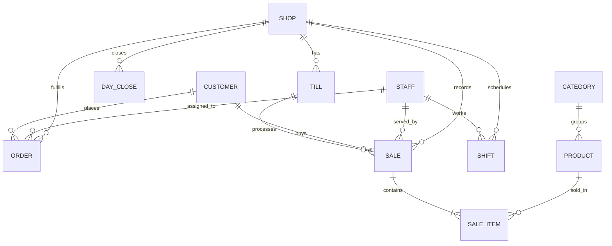

# SYSTEM_DESIGN.md — Petalo (Marigold & Moss POS & Back Office)

## 1. High-Level Architecture (HLD)
Petalo is a 1:1 clean-room full-stack replica of a 13-page Point of Sale (POS) and Back-Office application for a two-shop florist (**Marigold & Moss**: `Canal St` and `Market Hall`).

- **Frontend (`frontend/`)**: React 18 + TypeScript + Vite SPA with CSS custom-property design tokens (`dark` primary `#171615`, `light` `#f0eee9`, coral accent `#f28571`), responsive layout (desktop/tablet/phone), custom botanical line-art SVGs, interactive charts, and drag-and-drop Kanban/Rota boards.
- **Backend (`backend/`)**: FastAPI + SQLite (`petalo.db`) providing RESTful CRUD, checkout transactions, order stage transitions, stock vase-life & delivery check-ins, shift rota updates, till counts, and day-close exports.
- **Real-Time Consistency**: Completing a sale in `Register` atomically records the `Sale` + `SaleItem`s, increments the active `Till` expected cash (if cash) or card/phone/gift settlement, decrements `Product`/`Stem` stock, and refreshes `Overview` (`Takings`, `Till feed`, `How they paid`, `Best sellers`, `Tills`), `Sales`, `Payments`, and `Stock`.

---

## 2. Entity-Relationship Diagram (ERD)

### Core Entities & Fields
1. **`Shop`**: `id` (`canal`, `market`), `name` (`Canal St`, `Market Hall`), `address`, `phone`, `close_time` (`19:00`, `17:00`), `tax_rate` (`0.08`).
2. **`Staff`**: `id`, `name`, `initials`, `role`, `shop_id`, `pin`, `active_on_floor` (bool), `avatar_color`.
3. **`Product` (Catalog & Stems)**: `id`, `sku`, `name`, `category` (`Bouquets`, `Single stems`, `Plants`, `Gifts & vases`, `Workshops`), `price_cents`, `unit_label` (`""` or `"/ stem"`), `stock_qty`, `par_level`, `vase_life_days` (nullable int for stems), `freshness_status` (`Fresh`, `Soon`, `Use today`), `icon_key`, `shop_id`.
4. **`Customer`**: `id`, `name`, `email`, `phone`, `tier` (`Regular`, `VIP`, `Corporate`), `notes`, `total_spent_cents`, `visits_count`, `created_at`.
5. **`Order`**: `id`, `code`, `title`, `customer_id`, `customer_name`, `shop_id`, `fulfillment` (`Collect`, `Delivery`), `stage` (`New`, `Arranging`, `Ready`, `Out for delivery`, `Handed over`), `due_at` (ISO/time string), `assigned_staff_id`, `payment_status` (`Paid`, `Unpaid`), `total_cents`, `notes`, `position`.
6. **`Till`**: `id`, `shop_id`, `label` (`Canal · Till 1`, `Canal · Till 2`, `Market · Till 1`), `staff_id`, `opened_at`, `opening_float_cents`, `expected_cash_cents`, `status` (`Open`, `Closed`).
7. **`Sale`**: `id`, `receipt_no`, `shop_id`, `till_id`, `staff_id`, `customer_id`, `subtotal_cents`, `discount_type` (`None`, `Regular 10%`, `Staff 20%`), `discount_cents`, `tax_cents`, `tip_cents`, `total_cents`, `payment_method` (`Card`, `Phone pay`, `Cash`, `Gift card`), `cash_tendered_cents`, `change_cents`, `status` (`Completed`, `Refunded`), `summary_text`, `created_at`.
8. **`SaleItem`**: `id`, `sale_id`, `product_id`, `name`, `qty`, `unit_price_cents`, `line_total_cents`.
9. **`Shift`**: `id`, `staff_id`, `shop_id`, `day_of_week` (`Mon`–`Sun`), `start_time`, `end_time`, `role_label`.
10. **`DeliveryCheckIn` (Stock Deliveries)**: `id`, `supplier`, `shop_id`, `items_summary`, `stem_count`, `status` (`Expected`, `Checked in`), `eta`.
11. **`DayClose`**: `id`, `shop_id`, `closed_by`, `date_label`, `total_sales_cents`, `cash_counted_cents`, `variance_cents`, `created_at`.
12. **`Settings`**: `business_name` (`Marigold & Moss`), `tax_rate_pct` (`8`), `receipt_footer`, `tip_prompt_enabled`, `auto_lock_minutes`, `theme` (`dark` | `light`).

---

## 3. REST API Contract (`/api/...`)
- `GET /api/health` — Health check.
- `GET /api/bootstrap?shop=all` — Returns full initial state (shops, staff, products, orders, sales, tills, customers, shifts, deliveries, day_closes, settings, overview aggregates).
- `GET /api/overview?shop=all&range=today|week|month` — Aggregated takings series (hourly vs last Friday, daily vs week before, monthly), KPIs, pick-ups/deliveries, best sellers, payment breakdown, till feed, use-first stems, and drawer cash.
- `POST /api/sales` — Atomic checkout: creates `Sale` + `SaleItem`s, updates `Till.expected_cash_cents` (if Cash), decrements `Product.stock_qty`, updates `Customer.total_spent_cents`.
- `POST /api/sales/{id}/refund` — Marks sale `Refunded` and adjusts totals.
- `GET /api/orders`, `POST /api/orders`, `PATCH /api/orders/{id}` — Create order, drag-and-drop stage/position update, edit order.
- `GET /api/products`, `POST /api/products`, `PATCH /api/products/{id}` — Catalog & stock adjustments.
- `POST /api/deliveries/{id}/checkin` — Check in stem delivery and increment stock.
- `GET /api/customers`, `POST /api/customers`, `PATCH /api/customers/{id}` — Customer CRUD.
- `GET /api/shifts`, `POST /api/shifts`, `PATCH /api/shifts/{id}` — Drag-and-drop rota shift updates.
- `POST /api/tills/{id}/close`, `POST /api/day-closes` — Till count/close & end-of-day close.
- `PATCH /api/settings` — Update shop/POS settings.

---

## 4. Behavioral State Machines
1. **Register Checkout**:
   `Cart Building (add/remove/qty/discount/customer)` -> `Click Charge $X` -> `Step 1: Payment Method (Card | Phone pay | Cash | Gift card)` -> `Step 2: Tip Prompt (No tip | 10% | 15% | 20%)` *(or Cash tender & change calculator)* -> `Step 3: Terminal / Approving...` -> `Step 4: Paid Receipt (tilted green PAID stamp, Print / Email / + New sale)` -> `POST /api/sales` -> `Optimistic/Confirmed refresh of Overview, Sales, Tills, Stock`.
2. **Orders Kanban Drag-and-Drop**:
   `Pointer/HTML5 Drag Start` -> `Card Tilt + Dropzone Highlight` -> `Drop on Target Column` -> `Optimistic Move + Toast ("<Title> -> <Stage>" with Undo)` -> `PATCH /api/orders/{id}` (rollback on failure).
3. **Global Omnibar (`⌘K` / `Ctrl+K`)**:
   Filters orders, products/stems, customers, and routes in real time; `Enter` navigates directly; `Esc` closes.
